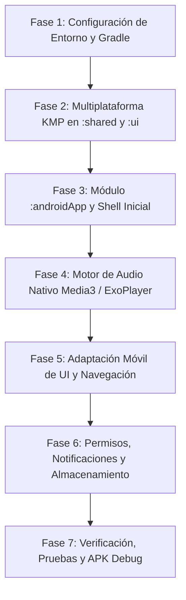

# MaviMusic Android: Hoja de Ruta y Arquitectura de Implementación

Este documento define la planificación técnica, arquitectura y fases de ejecución para portar **MaviMusic** a Android aprovechando que el núcleo de la aplicación ya está desarrollado en **Kotlin Multiplatform (KMP)** y **Compose Multiplatform**.

> Revisión del 29 de octubre de 2026: las casillas históricas describen entregas de
> implementación, no una aceptación completa de cada función. La estabilización,
> sus pruebas y los pendientes confirmados se registran en [ANDROID_HANDOFF.md](ANDROID_HANDOFF.md).

---

## 1. Diagnóstico del Estado Actual y Reutilización de Código

El proyecto actual consta de tres módulos:
- `:shared`: Modelos de datos, repositorios (`YtMusicRepository`, `InnertubeX`, `NewPipeExtractor`), clientes de red Ktor (OkHttp, WebSockets), planificador de Automix y servidor local para Web App / Remote Control.
- `:desktopUi`: Vistas completas en Jetpack/Compose Multiplatform (`HomeScreen`, `ExploreScreen`, `SearchScreen`, `LibraryScreen`, `NowPlayingScreen`, reproductores, colas, letras sincronizadas, paletas de color y componentes visuales).
- `:desktopApp`: Entrada JVM para escritorio, integración nativa macOS/Windows y motor de audio Java Sound (`SourceDataLine`).

### Nivel de Reutilización Estimado
- **Lógica de negocio y modelos (:shared):** ~95% reutilizable directamente en Android.
- **Interfaces de usuario (:desktopUi):** ~85% reutilizable mediante Compose Multiplatform.
- **Subsistemas a implementar específicamente en Android:**
  1. Motor de reproducción de audio y sesión multimedia (`AndroidX Media3 / ExoPlayer` + `MediaSessionService`).
  2. Integración móvil (Bottom Navigation Bar, Edge-to-Edge `WindowInsets`, soporte táctil / gestual).
  3. Almacenamiento y permisos nativos de Android (notificaciones, servicio en primer plano, directorios de caché).

---

## 2. Plan de Fases de Ejecución

### Fase 1: Configuración de Entorno y Gradle
- [x] Configuración de Android SDK en el entorno local (`platform-tools`, `platforms;android-35`, `build-tools;35.0.0`, `cmdline-tools`).
- [x] Inclusión de `local.properties` con `sdk.dir`.
- [x] Integración de plugins Android (`com.android.application` y `com.android.library`) en `build.gradle.kts`.
- [x] Declaración del módulo `:androidApp` en `settings.gradle.kts`.

### Fase 2: Soporte Android en Módulos Compartidos
- [x] Configurar `androidTarget()` en `:shared/build.gradle.kts`.
- [x] Configurar `androidTarget()` en `:desktopUi/build.gradle.kts`.
- [x] Implementación de `actual` para Android (`Haptics.android.kt`, `ContextClick.android.kt`, `StatusBarIcons.android.kt`, `PlayerPlatformUi.android.kt`, `ArtworkPixels.android.kt`).
- [x] Migración de `PaletteQuantizer.kt` a `jvmSharedMain`.

### Fase 3: Módulo `:androidApp` y Shell Inicial
- [x] Estructura estándar de Android:
  - [x] `AndroidManifest.xml` con declaración de permisos y componentes.
  - [x] `MainActivity.kt` como punto de entrada utilizando `ComponentActivity` y `setContent { ... }`.
  - [x] Iconos y recursos para Android (`res/values`, `res/mipmap`, etc.).

### Fase 4: Motor de Audio Nativo (`Media3` / `ExoPlayer`)
En Android, el audio no puede ejecutarse en un hilo simple de JVM como en escritorio porque el sistema operativo detendría el proceso al suspender la pantalla o pasar a segundo plano.
- [x] Implementación de `MediaSessionService` con `AndroidX Media3`:
  - [x] `PlaybackService.kt` para reproducción continua en segundo plano.
  - [x] `AndroidPlayerEngine.kt` para orquestar la reproducción con `ExoPlayer`, manejo de colas, seek y estados.
  - [x] Resolución de stream directa mediante `StreamResolver` de `:shared` con cabeceras de cliente YouTube.
  - [x] Notificación persistente con metadatos multimedia (`MediaMetadata`).
  - [x] `AudioAttributes` y manejo nativo de `AudioFocus` y desconexión de auriculares (`ACTION_AUDIO_BECOMING_NOISY`).

### Fase 5: Adaptación Móvil de UI y Navegación
- [x] Barra de navegación inferior móvil (`NavigationBar` / `NavigationBarItem`) para Inicio, Explorar, Biblioteca y Buscar.
- [x] Mini-reproductor persistente flotante en la parte inferior con control de Play/Pausa y carátula.
- [x] Integración de `NowPlayingScreen` completa conectada al playhead y controles.
- [x] Soporte para gestos nativos de retroceso con `BackHandler`.
- [x] Integración de `WindowInsets` de Compose (`statusBarsPadding`, `navigationBarsPadding`).

### Fase 6: Almacenamiento, Persistencia y Descargas Offline
- [x] Persistencia parcial de sesión (`AndroidPreferences`): última canción reproducida, cola activa e índice, historial de búsquedas recientes. La posición de reproducción aún no se persiste.
- [x] Gestor de descargas (`OfflineDownloadManager`): descarga de audio y metadatos JSON a almacenamiento aislado (`getExternalFilesDir`).
- [x] Reproducción offline transparente: `AndroidPlayerEngine` detecta archivos locales descargados y los reproduce directamente con ExoPlayer sin consumir datos de red.
- [x] Sección "Descargas Offline" en pestaña Biblioteca con botón de reproducción total y gestión de pistas guardadas.
- [x] Icono de descarga dinámica en cada fila de canción (`SongRowItem`) para guardar o eliminar con 1 toque.
- [x] Permisos de Android:
  - `android.permission.POST_NOTIFICATIONS`
  - `android.permission.FOREGROUND_SERVICE`
  - `android.permission.FOREGROUND_SERVICE_MEDIA_PLAYBACK`
  - `android.permission.INTERNET`
  - `android.permission.ACCESS_NETWORK_STATE`

### Fase 7: Compilación, Despliegue USB y Pruebas
- [x] Script automatizado de compilación y despliegue USB: `scripts/deploy_android.sh`.
- [x] Verificado y ejecutándose activamente en dispositivo físico (Samsung Galaxy Tab SM-X110 / Android 14/15) vía ADB.
- [x] Verificación de no-regresión en Desktop (macOS y Windows): suite de 33 tests pasando en <1s.

### Fase 8: Funcionalidades Avanzadas Móviles
- [x] **Favoritos ("Me Gusta"):** Marcado desde el reproductor a pantalla completa (`LikeStatus.LIKE`) y pestaña dedicada en Biblioteca.
- [x] **Playlists personalizadas:** Creación de listas locales, añadir pistas desde cualquier vista (`SongRowItem`), gestión y eliminación.
- [x] **Modo Radio continuo:** Generación de radio basada en un tema y recarga automática de canciones similares al agotar la cola. No integra el motor DSP de Automix del escritorio.
- [x] **Diseño Adaptativo para Tablet:** En pantallas anchas (`>= 720dp`), activación automática de `NavigationRail` lateral izquierdo dejando libre la pantalla para cuadrículas y mini-player estilizado.
- [x] **Temporizador de apagado (Sleep Timer):** Modal con tiempos (15, 30, 45, 60 min o al terminar canción) con cuenta regresiva en vivo y pausa suave de ExoPlayer.
- [x] **Escáner de archivos locales (`MediaStore`):** Detección y reproducción de archivos MP3/FLAC del almacenamiento de la tablet.
- [ ] **Sincronización con Escritorio:** Existe el modal de IP y PIN, pero faltan conexión, autenticación y sincronización real con `DesktopRemoteServer`.

---

## 3. Compatibilidad con Políticas de Lanzamiento (AGENTS.md)

- Los artefactos de Android (`.apk`) se generarán exclusivamente en modo **Debug** / prueba interna local.
- No se crearán tags de release ni publicaciones de GitHub públicas sin instrucción explícita del usuario.
- Los módulos existentes `:desktopApp` y workflows de release permanecen protegidos y sin modificaciones destructivas.
