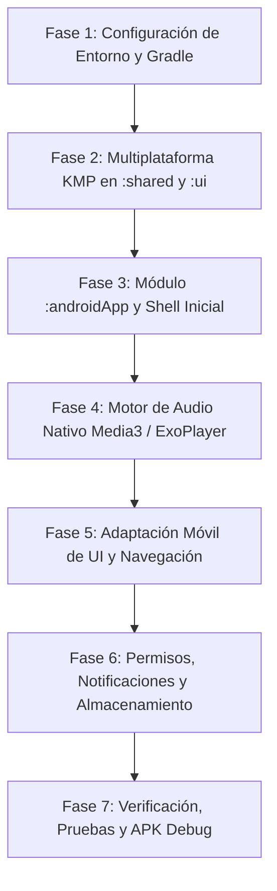

# MaviMusic Android: Hoja de Ruta y Arquitectura de Implementación

Este documento define la planificación técnica, arquitectura y fases de ejecución para portar **MaviMusic** a Android aprovechando que el núcleo de la aplicación ya está desarrollado en **Kotlin Multiplatform (KMP)** y **Compose Multiplatform**.

---

## 1. Diagnóstico del Estado Actual y Reutilización de Código

El proyecto actual consta de tres módulos:
- `:shared`: Modelos de datos, repositorios (`YtMusicRepository`, `InnertubeX`, `NewPipeExtractor`), clientes de red Ktor (OkHttp, WebSockets), planificador de Automix y servidor local para Web App / Remote Control.
- `:desktopUi`: Vistas completas en Jetpack/Compose Multiplatform (`HomeScreen`, `ExploreScreen`, `SearchScreen`, `LibraryScreen`, `NowPlayingScreen`, reproductores, colas, letras sincronizadas, paletas de color y componentes visuales).
- `:desktopApp`: Entrada JVM para escritorio, integración nativa macOS/Windows y motor de audio Java Sound (`SourceDataLine`).

### Nivel de Reutilización Estimado
- **Lógica de negocio y modelos (:shared):** ~95% reutilizable directamente en Android.
- **Interfaces de usuario (:desktopUi):** ~85% reutilizable mediante Compose Multiplatform.
- **Subsistemas a implementar específicamente en Android:**
  1. Motor de reproducción de audio y sesión multimedia (`AndroidX Media3 / ExoPlayer` + `MediaSessionService`).
  2. Integración móvil (Bottom Navigation Bar, Edge-to-Edge `WindowInsets`, soporte táctil / gestual).
  3. Almacenamiento y permisos nativos de Android (notificaciones, servicio en primer plano, directorios de caché).

---

## 2. Plan de Fases de Ejecución

### Fase 1: Configuración de Entorno y Gradle
- [x] Configuración de Android SDK en el entorno local (`platform-tools`, `platforms;android-35`, `build-tools;35.0.0`, `cmdline-tools`).
- [x] Inclusión de `local.properties` con `sdk.dir`.
- [x] Integración de plugins Android (`com.android.application` y `com.android.library`) en `build.gradle.kts`.
- [x] Declaración del módulo `:androidApp` en `settings.gradle.kts`.

### Fase 2: Soporte Android en Módulos Compartidos
- Configurar `androidTarget()` en `:shared/build.gradle.kts`.
- Configurar `androidTarget()` en `:desktopUi/build.gradle.kts` (o configurar el módulo de UI como módulo común multiplatform).
- Resolver dependencias multiplataforma para Android:
  - `ktor-client-okhttp` (ya compatible con Android).
  - `coil3` (compatible con Android y Compose Multiplatform).
  - `haze` (compatible con Android).

### Fase 3: Módulo `:androidApp` y Shell Inicial
- Estructura estándar de Android:
  - `AndroidManifest.xml` con declaración de permisos y componentes.
  - `MainActivity.kt` como punto de entrada utilizando `ComponentActivity` y `setContent { AppUi(...) }`.
  - Iconos y recursos para Android (`res/values`, `res/mipmap`, etc.).

### Fase 4: Motor de Audio Nativo (`Media3` / `ExoPlayer`)
En Android, el audio no puede ejecutarse en un hilo simple de JVM como en escritorio porque el sistema operativo detendría el proceso al suspender la pantalla o pasar a segundo plano.
- Implementación de `MediaSessionService` con `AndroidX Media3`:
  - `PlaybackService.kt` para reproducción continua en segundo plano.
  - Notificación enriquecida persistente con carátula, botones de play/pause, anterior/siguiente y seekbar.
  - Soporte de pantalla de bloqueo y controles Bluetooth / Android Auto.
  - `AudioFocusRequest` para pausar la música en llamadas entrantes o reducir volumen con notificaciones.

### Fase 5: Adaptación Móvil de UI y Navegación
- Soporte para orientación vertical típica de smartphone con opción a pantalla completa en apaisado.
- Barra de navegación inferior móvil (`NavigationBar` / `NavigationBarItem`) para Inicio, Explorar, Biblioteca y Buscar.
- Mini-reproductor persistente flotante en la parte inferior con gesto deslizante hacia arriba para abrir `NowPlayingScreen`.
- Integración de `WindowInsets` de Compose para respetar barras de estado, navegación por gestos y orificios de cámara (notch/isla).

### Fase 6: Almacenamiento y Permisos
- Directorio de caché y descarga offline usando `context.filesDir` / `context.getExternalFilesDir()`.
- Permisos de Android 13+:
  - `android.permission.POST_NOTIFICATIONS`
  - `android.permission.FOREGROUND_SERVICE`
  - `android.permission.FOREGROUND_SERVICE_MEDIA_PLAYBACK`
  - `android.permission.INTERNET`
  - `android.permission.ACCESS_NETWORK_STATE`

### Fase 7: Compilación y Pruebas
- Tarea Gradle `./gradlew :androidApp:assembleDebug` para generar el APK instalable.
- Verificación de no-regresión: comprobar que las tareas de compilación y pruebas de macOS y Windows (`:desktopApp`) sigan funcionando al 100% sin alteraciones.

---

## 3. Compatibilidad con Políticas de Lanzamiento (AGENTS.md)

- Los artefactos de Android (`.apk`) se generarán exclusivamente en modo **Debug** / prueba interna local.
- No se crearán tags de release ni publicaciones de GitHub públicas sin instrucción explícita del usuario.
- Los módulos existentes `:desktopApp` y workflows de release permanecen protegidos y sin modificaciones destructivas.
